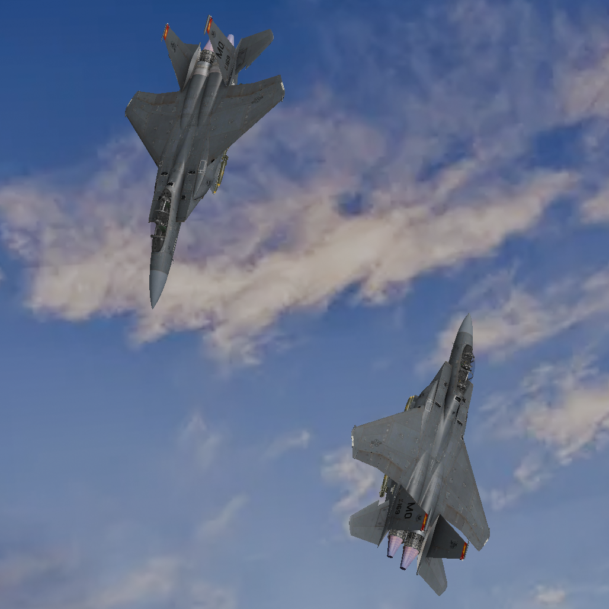

  

  <h3 align="center">**Jet Fighter Web Game**</h3>

  

    A three.js based dogfighting game with small-scale multiplayer
  

## Highlights.
 - Physics based flight/controls with Rapier3d.
 - keyboard/Mouse control scheme with the ability to shoot bullets.
 - Optimizations for physics interactions like bullet collisions to reduce memory/cpu usage.
 - Simple cube map with Skybox textures.
 - Basic multiplayer server which coordinates player positions

## Overview
The project is currently in early development with only the basic features implemented, both for the server and client side code.
The player can fly around in a 3d model of a jet and shoot physics based projectiles in order to destroy enemy planes. Other players
can join the host server through a browser without the installation of external software and play the game. This
project started out as an attempt at learning JavaScript alongside a curiosity for browser based games, and now sits at 50% complete with
more features to come down the line.

## Showcase

<h3 align="center">In-game image of 2 players dogfighting</h3>

  

### Built with

[![Threejs][threejs]][threejsURL]
[![openGL][openGL]][expressURL]
[![Typescript][typescript]][typescriptURL]

## Setup

- Install/Clone the repository onto your system.
- Run npm install
- Open powershell/command prompt and navigate to root folder
- To build three js code run "npx webpack". This will output a bundle.js to app/dist/
- To start server run "node server.js" inside /app folder

## Roadmap
- [x] Three Js Scene setup with jet model
  - [x] Basic air movement 
  - [x] Shooting mechanic
  - [ ] jet animations
  - [ ] bullet 3d model
- [ ] Health/Damage System
- [x] Working multiplayer
  - [ ] Synchronizing position/direction between players
  - [ ] Damage/Destroy other players

## Acknowledgments
Check Credits For full accreditations.

* [**Jet Model**](https://skfb.ly/pK7WN)
* [**Three.js Multiplayer implementation**](https://github.com/juniorxsound/THREE.Multiplayer#installation)

[threejs]: https://img.shields.io/badge/ThreeJS-orange?style=for-the-badge&logo=threedotjs
[openGL]: https://img.shields.io/badge/-ExpressJS-black?style=for-the-badge&logo=express&logoColor=white
[typescript]: https://img.shields.io/badge/-TypesScript-blue?style=for-the-badge&logo=typescript&logoColor=white

  
[expressURL]: https://expressjs.com/
[threejsURL]: https://threejs.org/
[typescriptURL]: https://www.typescriptlang.org/

